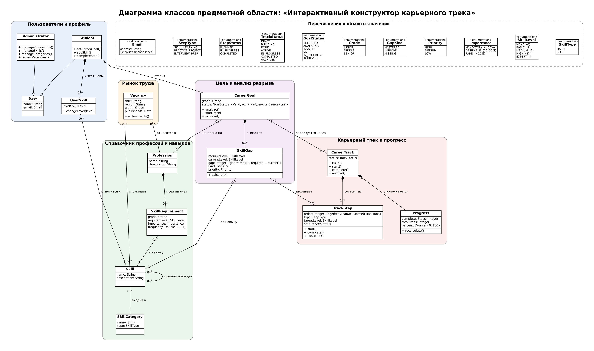

# Диаграмма классов предметной области

## 1. Введение

**Цель шага.** Построить концептуальное представление сущностей предметной области: из каких бизнес-объектов состоит система «Интерактивный конструктор карьерного трека», какие данные они хранят, какое поведение (бизнес-правила) за ними закреплено и как они связаны друг с другом.

**Зачем это нужно.** Диаграмма классов — «грамматика» приложения: она показывает, какие сущности существуют и как они взаимодействуют. Результат шага используется для верхнеуровневого проектирования: **группы связанных доменных объектов определяют границы будущих компонентов архитектуры** (главное правило: границы архитектуры определяются границами домена).

**Что осознанно не показано.** Диаграмма не содержит технической детализации: нет идентификаторов, внешних ключей, таблиц, индексов, хеширования паролей, API и интеграций. Это уровень модели данных и архитектуры (следующие этапы).

**На чём основана диаграмма.**

| Источник | Что взято |
|---|---|
| [`domain-analysis.md`](domain-analysis.md) | термины, бизнес-правила БП-1…БП-8, список сущностей |
| [`State_Machine_Diagrams.md`](State_Machine_Diagrams.md) | состояния `Career Goal`, `Career Track`, `Track Step` → перечисления статусов и методы |
| [`Requirements-Analysis.md`](Requirements-Analysis.md) | FR (уровни 0–4, формула Skill Gap, пороги важности навыков, шаги трека), роли и акторы |
| [`README.md`](../README.md) | перечень предполагаемых сущностей и ролей |

---

## 2. Диаграмма

> Цвета фона — группы классов, которые предлагается рассматривать как границы будущих компонентов (раздел 5). Внизу — перечисления и объект-значение, на которые ссылаются атрибуты.

---

## 3. Условные обозначения (UML)

| Обозначение | Смысл | Где применено |
|---|---|---|
| Сплошная линия | **Ассоциация** — «знает о», объекты живут независимо | `Student — CareerGoal`, `Skill — SkillCategory` и др. |
| Закрашенный ромб ◆ | **Композиция** — «жёстко состоит из», часть не существует без целого | `CareerTrack ◆ TrackStep`, `CareerGoal ◆ SkillGap` и др. |
| Пустой треугольник ▷ | **Наследование** — «является» | `Student ▷ User`, `Administrator ▷ User` |
| `1`, `0..*`, `1..*`, `0..1` | **Кратность** связи | у концов линий |
| `{ … }` / примечания | **Ограничения** и бизнес-правила | `gap = max(0, required − current)`, `percent 0..100` |
| `«enumeration»` | Перечисление допустимых значений | статусы, уровни, типы |
| `«value object»` | Объект-значение с собственной проверкой | `Email` |

---

## 4. Описание классов

### 4.1. Пользователи и профиль

| Класс | Назначение | Основные атрибуты и поведение |
|---|---|---|
| **User** *(абстрактный)* | Общее понятие пользователя системы | `name`, `email: Email` |
| **Student** | Основной пользователь: ставит цель, указывает навыки, проходит трек | `setCareerGoal()`, `addSkill()`, `completeStep()` |
| **Administrator** | Ведёт справочники и контролирует качество данных (FR-29…FR-32) | `manageProfessions()`, `manageSkills()`, `manageCategories()`, `reviewVacancies()` |
| **UserSkill** | Навык конкретного пользователя и уровень владения | `level: SkillLevel`, `changeLevel()` |
| **Email** *(value object)* | Адрес электронной почты с проверкой формата | `address` |

### 4.2. Справочник профессий и навыков

| Класс | Назначение | Основные атрибуты и поведение |
|---|---|---|
| **Profession** | Профессиональное направление | `name`, `description` |
| **SkillRequirement** | Требование профессии к навыку на определённом грейде | `grade`, `requiredLevel`, `importance`, `frequency` (доля вакансий, где навык встречается) |
| **Skill** | Компетенция (единый справочник навыков) | `name`, `description` |
| **SkillCategory** | Категория навыка (Hard / Soft) | `name`, `type: SkillType` |

### 4.3. Рынок труда

| Класс | Назначение | Основные атрибуты и поведение |
|---|---|---|
| **Vacancy** | Вакансия — источник требований рынка (БП-1) | `title`, `region`, `grade`, `publishedAt`, `extractSkills()` |

### 4.4. Цель и анализ разрыва

| Класс | Назначение | Основные атрибуты и поведение |
|---|---|---|
| **CareerGoal** | Карьерная цель: профессия + грейд | `grade`, `status: GoalStatus`, `analyze()`, `startTrack()`, `achieve()` |
| **SkillGap** | Разрыв между требуемым и текущим уровнем по одному навыку (БП-4, БП-5) | `requiredLevel`, `currentLevel`, `gap`, `kind: GapKind`, `priority`, `calculate()` |

### 4.5. Карьерный трек и прогресс

| Класс | Назначение | Основные атрибуты и поведение |
|---|---|---|
| **CareerTrack** | Последовательный план развития (БП-6, БП-8) | `status: TrackStatus`, `build()`, `start()`, `complete()`, `archive()` |
| **TrackStep** | Отдельный шаг трека | `order`, `type: StepType`, `targetLevel`, `status: StepStatus`, `start()`, `complete()`, `postpone()` |
| **Progress** | Текущее продвижение пользователя по треку | `completedSteps`, `totalSteps`, `percent`, `recalculate()` |

### 4.6. Перечисления

| Перечисление | Значения | Откуда |
|---|---|---|
| `SkillType` | HARD, SOFT | БП-2, FR-12 |
| `SkillLevel` | NONE(0), BASIC(1), MEDIUM(2), HIGH(3), EXPERT(4) | FR-4 (уровень 0–4) |
| `Importance` | MANDATORY (>50 %), DESIRABLE (20–50 %), RARE (<20 %) | FR-14 |
| `Priority` | HIGH, MEDIUM, LOW | FR-19 |
| `GapKind` | MASTERED, IMPROVE, MISSING | FR-18 |
| `Grade` | JUNIOR, MIDDLE, SENIOR | FR-3, определение Career Goal |
| `GoalStatus` | SELECTED, ANALYZING, INVALID, VALID, IN_PROGRESS, ACHIEVED | State Machine «Career Goal» |
| `TrackStatus` | DRAFT, BUILDING, EMPTY, ACTIVE, IN_PROGRESS, COMPLETED, ARCHIVED | State Machine «Career Track» |
| `StepStatus` | PLANNED, IN_PROGRESS, COMPLETED | State Machine «Track Step» |
| `StepType` | SKILL_LEARNING, PRACTICE_PROJECT, INTERVIEW_PREP | FR-25, FR-26 |

---

## 5. Связи между классами

| Связь | Тип | Кратность | Обоснование |
|---|---|---|---|
| `Student ▷ User`, `Administrator ▷ User` | наследование | — | Две реальные роли с общими данными профиля и разным поведением |
| `Student ◆ UserSkill` | композиция | 1 — 0..* | Навык пользователя не существует без пользователя |
| `UserSkill → Skill` | ассоциация | 0..* — 1 | Навык из справочника переиспользуется многими пользователями |
| `Student → CareerGoal` | ассоциация | 1 — 0..* | Пользователь может менять цель; цели архивируются вместе с треками |
| `CareerGoal → Profession` | ассоциация | 0..* — 1 | Цель нацелена на профессию из справочника |
| `CareerGoal ◆ SkillGap` | композиция | 1 — 0..* | Разрыв рассчитывается для конкретной цели и теряет смысл без неё (БП-4) |
| `SkillGap → Skill` | ассоциация | 0..* — 1 | Разрыв всегда по одному навыку |
| `CareerGoal → CareerTrack` | ассоциация | 1 — 0..* | Трек реализует цель; при смене цели трек архивируется, при пересборке может появиться новый |
| `CareerTrack ◆ TrackStep` | композиция | 1 — 1..* | Шаги не существуют вне трека |
| `CareerTrack ◆ Progress` | композиция | 1 — 1 | Прогресс — характеристика конкретного трека |
| `TrackStep → SkillGap` | ассоциация | 0..* — 0..1 | Шаг закрывает разрыв; у шагов «практический проект» и «подготовка к собеседованию» разрыва нет |
| `Profession ◆ SkillRequirement` | композиция | 1 — 0..* | Требование описывает профессию и не живёт отдельно |
| `SkillRequirement → Skill` | ассоциация | 0..* — 1 | Требование относится к навыку из справочника |
| `Skill → SkillCategory` | ассоциация | 0..* — 1 | Категория Hard/Soft (БП-2) |
| `Skill → Skill` | ассоциация | 0..* — 0..* | Зависимости между навыками, «предпосылка для» (БП-7) |
| `Vacancy → Profession` | ассоциация | 0..* — 1 | Вакансия относится к профессии |
| `Vacancy → Skill` | ассоциация | 0..* — 0..* | Вакансия упоминает навыки (БП-1) |

---

## 6. Группы классов и границы будущих компонентов

Композиции остаются внутри групп — такие классы должны «жить вместе». Связи между группами — места будущих интерфейсов и зависимостей между компонентами.

| № | Группа (кандидат в компонент) | Классы | Почему вместе |
|---|---|---|---|
| 1 | **Пользователи и профиль** | `User`, `Student`, `Administrator`, `UserSkill`, `Email` | Данные и навыки пользователя, роли |
| 2 | **Справочник профессий и навыков** | `Profession`, `SkillRequirement`, `Skill`, `SkillCategory` | Общие справочные данные, ими управляет администратор; композиция `Profession ◆ SkillRequirement` |
| 3 | **Рынок труда** | `Vacancy` | Внешние данные из API вакансий, отдельный жизненный цикл; замена источника не должна затрагивать ядро (NFR-16) |
| 4 | **Цель и анализ разрыва** | `CareerGoal`, `SkillGap` | Разрыв вычисляется только для цели; композиция `CareerGoal ◆ SkillGap` |
| 5 | **Карьерный трек и прогресс** | `CareerTrack`, `TrackStep`, `Progress` | Композиции `CareerTrack ◆ TrackStep` и `CareerTrack ◆ Progress` — единый жизненный цикл |

**Зависимости между группами** (связи, пересекающие границы):

- «Пользователи и профиль» → «Справочник» (UserSkill → Skill);
- «Пользователи и профиль» → «Цель и анализ разрыва» (Student → CareerGoal);
- «Цель и анализ разрыва» → «Справочник» (CareerGoal → Profession, SkillGap → Skill);
- «Цель и анализ разрыва» → «Карьерный трек» (CareerGoal → CareerTrack);
- «Карьерный трек» → «Цель и анализ разрыва» (TrackStep → SkillGap);
- «Рынок труда» → «Справочник» (Vacancy → Profession, Vacancy → Skill).

Вывод: **справочник — центральная зависимость** (на него ссылаются все остальные группы), поэтому его целесообразно выделять как отдельный, самостоятельный компонент.

---

## 7. Связь с другими артефактами

### 7.1. С диаграммами состояний

Состояния из State Machine стали значениями статусов, а переходы — методами классов, которые инкапсулируют правила перехода.

| Класс | Статус | Переходы → методы |
|---|---|---|
| `CareerGoal` | `GoalStatus`: Selected → Analyzing → Valid / Invalid → InProgress → Achieved | `analyze()` (Selected → Analyzing → Valid / Invalid; Valid, если найдено ≥ 5 вакансий), `startTrack()` (Valid → InProgress), `achieve()` (→ Achieved) |
| `CareerTrack` | `TrackStatus`: Draft → Building → Active / Empty → InProgress → Completed / Archived | `build()`, `start()`, `complete()`, `archive()` |
| `TrackStep` | `StepStatus`: Planned ⇄ InProgress → Completed | `start()`, `complete()`, `postpone()` (InProgress → Planned) |

### 7.2. С бизнес-правилами

| Правило | Где отражено на диаграмме |
|---|---|
| БП-1 Требования определяются по вакансиям | `Vacancy → Skill`, `Vacancy.extractSkills()`, `SkillRequirement.frequency` |
| БП-2 Навыки делятся на Hard и Soft | `SkillCategory.type: SkillType` |
| БП-3 Учитывается требуемый уровень | `SkillRequirement.requiredLevel: SkillLevel` |
| БП-4 Skill Gap = сравнение текущих навыков и требований | `SkillGap` (`requiredLevel`, `currentLevel`, `gap = max(0, required − current)`) |
| БП-5 Недостающие навыки становятся направлениями развития | `SkillGap.kind`, `SkillGap.priority` |
| БП-6 Трек формируется на основе Skill Gap | `TrackStep → SkillGap`, `CareerTrack.build()` |
| БП-7 Учёт зависимостей между навыками | `Skill → Skill` («предпосылка для»), `TrackStep.order` |
| БП-8 Последовательное движение к цели | `TrackStep.order`, `Progress` |

### 7.3. С функциональными требованиями

| Требование | Отражение |
|---|---|
| FR-3 Цель = профессия и уровень | `CareerGoal → Profession`, `CareerGoal.grade` |
| FR-4 Уровень навыка 0–4 | `SkillLevel` |
| FR-9 Фильтрация вакансий по профессии, уровню, региону | `Vacancy.region`, `Vacancy.grade`, `Vacancy → Profession` |
| FR-14 Обязательные / желательные / редкие требования | `Importance`, `SkillRequirement.frequency` |
| FR-17 Формула Skill Gap | ограничение у `SkillGap.gap` |
| FR-18 Освоенные / требующие улучшения / отсутствующие | `GapKind` |
| FR-19 Приоритет развития | `Priority` |
| FR-23, FR-24 Зависимости и порядок изучения | `Skill → Skill`, `TrackStep.order` |
| FR-25, FR-26 Практический проект, подготовка к собеседованию | `StepType` |
| FR-28 Отметка шага выполненным | `TrackStep.complete()`, `Student.completeStep()`, `Progress.recalculate()` |
| FR-29…FR-32 Администрирование | `Administrator.manage…()`, `reviewVacancies()` |

---

## 8. Принятые решения и допущения

1. **Состав классов шире таблицы сущностей в `domain-analysis.md`.** Добавлены `Profession`, `SkillCategory`, `SkillGap`, `Progress` (они есть в README, терминах и требованиях FR-29…FR-31) и роли `Student` / `Administrator`. При необходимости таблицу сущностей в `domain-analysis.md` стоит синхронизировать с диаграммой.
2. **`Skill Gap` и `Progress` оставлены классами**, потому что у них есть собственные атрибуты и правила (формула, приоритет, процент), а `Skill Gap` — центральное понятие проекта.
3. **Грейд (`Grade`) — отдельное перечисление**, а не строка: оно используется в цели, вакансии и требовании.
4. **Наследование использовано один раз** (`User` → `Student`, `Administrator`) — только там, где есть реальная иерархия ролей; в остальных случаях использована композиция.
5. **Технические сущности не включены:** пароль и его хеш, токены и сессии, история изменений профиля (FR-7), внешние системы (API вакансий, аутентификация). Они относятся к архитектуре и модели данных.
6. **Кратность «цель — трек» `1 — 0..*`:** по State Machine трек архивируется при смене цели; допускается несколько треков (архивные и текущий).
7. **Примечание к модели:** прогресс можно вычислять из статусов шагов; он вынесен в класс, чтобы показать его как самостоятельное понятие (термин «Прогресс» из `domain-analysis.md`).

---

## 9. Итог

Построена концептуальная диаграмма классов предметной области: **14 классов, 1 объект-значение и 10 перечислений**, связанные ассоциациями, композициями и одним наследованием. Диаграмма согласована со словарём терминов, бизнес-правилами, требованиями и диаграммами состояний. Выделены **5 групп классов**, которые станут основой для проектирования компонентов архитектуры на следующем этапе.
