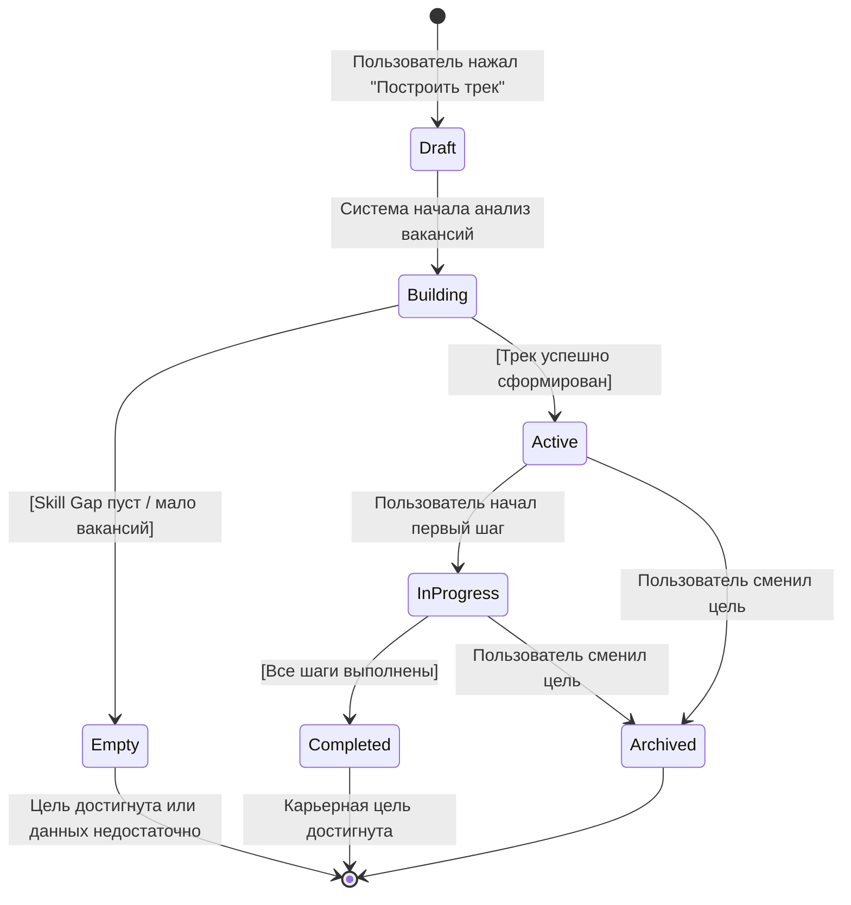
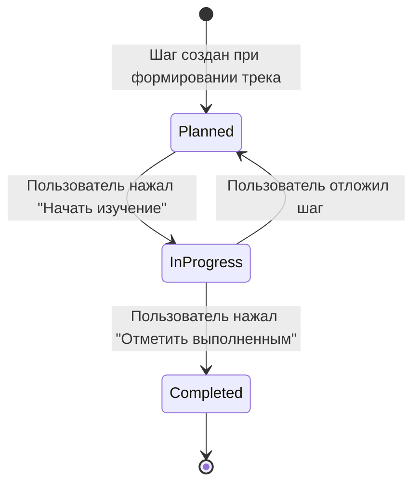
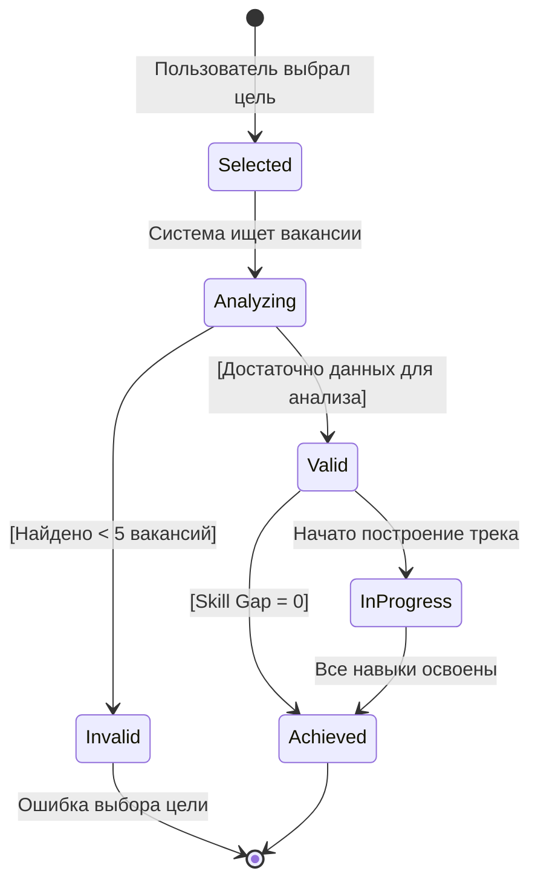

# Моделирование поведения сущности (State Machine Diagram)
---

## Введение
**State Machine Diagram** (диаграмма состояний) показывает жизненный цикл конкретной бизнес-сущности. Она требуется для дальнейшего поведенческого проектирования, уточняет бизнес-процессы и выявляет перечень допустимых состояний объекта.
---

## Выбор сущностей для моделирования

В проекте «Конструктор карьерного трека» не все сущности обладают сложным жизненным циклом. Например:
- **User** — имеет простой цикл (создан → активен → удалён), диаграмма не требуется.
- **Skill** — справочная сущность, состояния не меняются.
- **Vacancy** — внешние данные, управляются API.

Диаграммы состояний построены для **трёх сущностей**, которые имеют значимый жизненный цикл и бизнес-правила переходов:

| Сущность | Почему нужна диаграмма |
|----------|------------------------|
| **Career Track** | Главный объект системы: создаётся, строится, активируется, завершается или архивируется |
| **Track Step** | Каждый шаг имеет свой микрожизненный цикл: запланирован → в процессе → выполнен |
| **Career Goal** | Цель проходит валидацию (анализ вакансий), может быть достигнута или отклонена |
---

## Сущность «Career Track» (Карьерный трек)

###  Диаграмма состояний

### Сущность «Track Step» (Шаг карьерного трека)

### Сущность «Career Goal» (Карьерная цель)
